# California Legislative AI — Complete Architecture and Unified Pipeline (V12 Refined)

**Status:** Refined design specification (V12; not an implementation) based on V11 based on the existing BPC and SB 1453 datasets, the California Legislative Information site captures, and the planned temporal local-AI system.  
**Scope:** 29 California codes plus the California Constitution (30 crawler targets); statutes, legal hierarchy, subdivisions, bills, bill versions, analyses, votes, cross-references, amendment operations, provenance, time, SQL, JSON, retrieval, verification and UI.  
**Deployment:** Local-first Python + SQLite, original HTML/PDF archive, JSON exports; optional local embeddings/model.  
**Design rule:** Source text, extracted claims, validated relationships and AI-generated interpretations are four separate things.

## Contents

1. Goals, boundaries and evidence coverage
2. Source inventory and website navigation
3. Ingestion and immutable archival layer
4. Classification and document parsers
5. Statutory hierarchy and subdivision parsing
6. Bill, amendment and legislative history parsing
7. Cross-reference and bidirectional reconciliation
8. Historical, temporal and bitemporal modeling
9. Normalized relational database
10. JSON files, schemas and canonical IDs
11. Indexes and hybrid retrieval
12. Local AI tools, grounding and answer contract
13. Quality assurance, error recovery and observability
14. Folder structure and implementation roadmap
15. Worked examples and acceptance tests
16. **UNIFIED ARCHITECTURE — final synthesis**
17. V12 engineering decisions and corrections
18. Database invariants and migration-ready core SQL
19. Unified parser, provenance, and evidence contracts
20. Temporal reasoning and conflict resolution
21. Crawler orchestration, storage, and indexing
22. Legal NLP and precision-first retrieval
23. Product UI, extensibility, security and public launch
24. V12 test strategy and release gates

---

## 1. Goals, boundaries and evidence coverage

### 1.1 Primary outputs

| User-facing feature | Required structured evidence | Behavior when data is unavailable |
|---|---|---|
| Exact law lookup | Code, section, text version, source anchor | Say section not captured / unresolved |
| Hierarchical browser | Code > division > title > part > chapter > article > section > subdivision | Preserve missing or irregular levels |
| Historical law at date | Statute versions, legally applicable dates, exceptions | Report historical coverage gap |
| Legislative history | Bill ID, event dates, chapter, analyses, source | Do not infer legislative motive from a vote |
| Amendment diff | Chaptered bill section + before/after actual text | Mark as target-only when comparison missing |
| Cross-code references | Parsed citation, resolved target, source span | Keep unresolved raw references |
| Vote analysis | Roll calls, names, results, dates, vote counts | Keep unmatched names and counts for review |
| Source-supported AI answers | Source capture, span, validation status | Abstain from unsupported propositions |
| Change monitoring | Repeated captures and hashes | Distinguish capture changes from legal changes |
| Research reports | Exact evidence bundles and claim-to-source mappings | Include explicit qualifications |

### 1.2 Observed local material versus design

The following files have been inspected in the working directory; counts are **captured records**, not assertions that all California law is archived.

| Local input | Observed / prior validated scope | Status |
|---|---|---|
| `BPC_CODE_GROUPS_CAPTURED (2).json` | 992 seeds, 243 completed groups, 2,789 section records, 747 queued, 2 errors | Source captures; not complete |
| `BPC_SCHEMA_V4_BILL_HISTORY/` | 992-group manifest, 243 groups captured, 1,587 bill-linked section records, 327 derived bill IDs | Bill IDs/URLs derived; not all verified online |
| `BPC_SCHEMA_V3/` | Prior 90-group / 1,004-version subset and subdivision extraction | Older snapshot, **not** 243-group database |
| Seven SB 1453 bill HTML pages | Text, history, status, votes, analysis, version comparison, as-amends | Captured page views |
| `SB1453_SCHEMA_DESIGN_V6/` | 7 captures, 7 version identities, 35 event observations, 8 analyses, 208 section-view records, 165 candidate relationships | Candidate links require validation |
| `SB1453_VOTE_STORAGE_V8/` | 8 roll calls, 219 recorded legislator positions | Parsed and SQLite-validated subset |
| SB 1453 Assembly/Senate analysis PDFs | 6 and 8 pages respectively | Source documents; page-level anchors needed |
| BPC § 40 cross-reference, Compare, As-Amends HTML | Statute-side cross-reference and companion comparison views | Captured navigation/content |

**Do not conflate** chaptered bill text, statute text as shown currently, an older statutory version, a compare-view presentation and an AI reconstruction. Each is stored under its own source/type/version identity.

### 1.3 Non-goals for the first version

Do not begin with training a model on all statutes, generating court-outcome predictions, inventing missing historical text, or treating HTML/CSS diffs as legally operative amendments. Court decisions, regulations, rules and legislative publications can become later source families with separate schemas and authority metadata.

---

## 2. Source inventory and website navigation

### 2.1 Code branch

| Page family | Endpoint / navigation target | Capture |
|---|---|---|
| Code index | `codes.xhtml` | Code identifiers and links |
| Code table of contents | `codesTOCSelected.xhtml` | Hierarchy seed nodes |
| Expand hierarchy | `codedisplayexpand.xhtml` | Expanded tree and branches |
| Expanded branch | `codes_displayexpandedbranch.xhtml` | Division/title/part/chapter/article relationships |
| Code Group display | `codes_displayText.xhtml` | Section list, direct calls, HTML fragment |
| Individual section | `codes_displaySection.xhtml` | Exact section text and footer/history |
| Code ↔ bill cross-reference | `codeBillCrossRef.xhtml` | Affected statute, bill, chapter, operation |
| Code/bill comparison | `displayCodeAndBill.xhtml` | Corresponding bill-section comparison |
| As-amends page | `asAmendsTheBill.xhtml` | Law-as-amended presentation |

### 2.2 Bill branch

| Page family | Endpoint | Capture |
|---|---|---|
| Bill text / versions | `billTextClient.xhtml` | Version selector, digest and legislative sections |
| Legislative history | `billHistoryClient.xhtml` | Dated actions |
| Status | `billStatusClient.xhtml` | Status and recent actions |
| Analysis | `billAnalysisClient.xhtml` | Analysis index and source links |
| Votes | `billVotesClient.xhtml` | Roll calls and individual positions |
| Today's Law As Amended | `billCompareClient.xhtml` | As-amended presentation |
| Compare bill versions | `billVersionsCompareClient.xhtml` | Two-version comparison controls |
| Bill PDF | `billPdf.xhtml` | PDF for specific bill version |

**Navigation contract:** Save `requested_url`, `final_url`, form ID, DOM element/selector, `onclick`, parameters, form fields, selected version and the resulting capture ID. Keep the source's original spelling of JSF parameters (`op_statues`, for example) alongside normalized aliases. JSF view-state is ephemeral navigation state, **not** a permanent document identity. A derived direct URL is a candidate until checked.

### 2.3 Discovery queue lifecycle

`DISCOVERED → QUEUED → RUNNING → CAPTURED → CLASSIFIED → EXTRACTED → VALIDATED → INDEXED`.

Side branches: `RETRY`, `REVIEW`, `FAILED`, and `UNRESOLVED`. Preserve attempts, screenshots/logs where useful, parser version and error category. A successful HTTP response is not proof that expected legal content was present.

---

## 3. Ingestion and immutable archival layer

### 3.1 Capture transaction

1. Acquire source through Selenium/Playwright, Tampermonkey export or direct permissible download.
2. Record source URL, retrieval method, HTTP metadata if available and UTC capture timestamp.
3. Save the **original bytes** before parsing.
4. Optionally save a second **rendered DOM snapshot**; do not treat it as identical to raw response.
5. Calculate SHA-256 separately for each byte representation.
6. Register a `source_object` by digest and a distinct `source_capture` for every capture event.
7. Enqueue parsing with a versioned parser profile; never modify the source object.

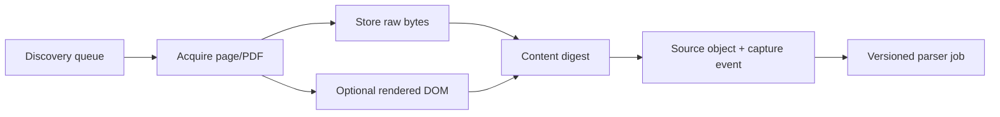

### 3.2 Distinct identities

- **Source object:** immutable content-addressed bytes (`sha256:<digest>`).
- **Capture event:** one retrieval, with its own time, navigation, URL and success/failure status.
- **Extraction run:** specific parser version + source object + configuration hash.
- **Source anchor:** precise DOM XPath, element ID, character offsets, PDF page and bounding box as appropriate.
- **Fact assertion:** extracted claim pointing to one or more source anchors.

A matching hash provides file-integrity evidence, not proof that the document is legally controlling.

### 3.3 Content retention

Store `text_exact`, `html_fragment`, original bytes path, encoding and normalized text separately. Keep conversion mappings and offsets so any normalized segment can be traced back to source text. For PDFs, preserve original pages and page-aware extraction; use OCR only when a page lacks usable text, with explicit OCR provenance and lower confidence.

---

## 4. Classification and document parsers

### 4.1 Classification

Classify by structural features and URL together; never solely by file title. Expected types: `CODE_TOC`, `CODE_BRANCH`, `CODE_GROUP`, `CODE_SECTION`, `CODE_BILL_XREF`, `CODE_BILL_COMPARE`, `CODE_AS_AMENDS`, `BILL_TEXT`, `BILL_HISTORY`, `BILL_STATUS`, `BILL_ANALYSIS`, `BILL_VOTES`, `BILL_VERSIONS_COMPARE`, `BILL_AS_AMENDS`, `PDF_ANALYSIS`, `PDF_BILL`, `UNKNOWN`.

Record classification evidence: endpoint, `h1`, detected forms, element IDs and selectors. Classifier disagreements go to review.

### 4.2 Parser outputs

| Parser | Output entities | Do not discard |
|---|---|---|
| Hierarchy | `hierarchy_node`, `code_group` | Original headings and navigational ordering |
| Section | `section_occurrence`, `statute_version`, paragraphs | Italic legislative history footer and raw fragments |
| Subdivision | `subdivision_node` | Unmarked paragraphs, ambiguous markers |
| Bill text | `bill_version`, `bill_section`, digest | Text and individual legislative-section order |
| Enacting clause | `amendment_target` | Exact wording of operation and ordered targets |
| History/status | `legislative_event`, status observations | Date text and duplicate source observations |
| Analysis PDF | `analysis_document`, `pdf_page`, `analysis_heading` | Full page text and position |
| Votes | `roll_call`, `vote_position` | Totals, raw legislator strings and motion |
| Cross-reference | `statute_bill_xref`, navigation action | Chapter, bill version section ID, source URLs |
| Compare/as-amends | `comparison_view`, `change_span` | Source presentation and diff markup |
| Citation | `citation_edge` | Raw phrase, source span, unresolved targets |
| Temporal | `time_assertion`, `commencement_rule` | Exact time language and uncertainty |

### 4.3 Extraction quality statuses

`UNPARSED`, `PARSED`, `PARTIAL`, `REVIEW`, `VALIDATED`, `FAILED`. One parser can succeed while another fails on the same archived source; do not overwrite the original extraction record without a new extraction-run ID.

---

## 5. Statutory hierarchy and subdivisions

### 5.1 Legal hierarchy

```
California
└── Code (BPC)
    └── Division (when present)
        └── Title (when present)
            └── Part (when present)
                └── Chapter (when present)
                    └── Article (when present)
                        └── Section (e.g. 1601.1)
                            └── Paragraph
                                └── (a)
                                    └── (1)
                                        └── (A)
                                            └── (i)
```

Do not impose one fixed ordering of division/title/part/chapter/article across all codes. Preserve **actual source parent/child structure** and optional levels. Keep both the exact labels and normalized keys. Multiple occurrences of one section in captures remain separate observations pointing to one canonical section identity.

### 5.2 Stable identity versus version

- `statute_id = BPC:1601.1` — stable section identity.
- `statute_version_id` — version-specific immutable text identity (explicit provenance, not merely calendar year).
- `section_occurrence_id` — source location of a particular capture.
- `subdivision_node_id` — specific node in a specific version (parent, marker, legal path, order).

If subdivisions are rearranged across versions, `(a)(1)` in 2020 is not automatically semantically equivalent to `(a)(1)` in 2024. Store version-bound nodes and add verified cross-version correspondences separately.

### 5.3 Subdivision record

```json
{
  "statute_version_id": "<version-id>",
  "node_id": "<node-id>",
  "parent_node_id": null,
  "marker_exact": "(i)",
  "marker_type": "roman_lower",
  "legal_path": "(a)(1)(A)(i)",
  "depth": 4,
  "document_order": 12,
  "text_exact": "<source text>",
  "html_fragment": "<source HTML fragment>",
  "source_anchor_id": "<anchor-id>",
  "start_offset": null,
  "end_offset": null,
  "confidence": null,
  "validation_status": "REVIEW"
}
```

**Validation:** legal paths unique within their own version and occurrence scope; child/parent depth consistent; byte/text offsets match source; marker grammar context-sensitive. Preserve detected anomalies rather than silently rewriting statutory text.

---

## 6. Bills, amendments, events, votes and analyses

### 6.1 Bill entity tree

```
BILL: 202320240SB1453
├── Bill identity (session, chamber, number, author, title)
├── Versions (introduced → amended → enrolled → chaptered)
│   ├── Legislative digest
│   ├── Exact legislative sections / SEC. numbers
│   └── Source HTML/PDF
├── Dated legislative events and status observations
├── Committee and floor analyses (HTML indexes and original PDFs)
├── Roll calls (date, chamber, motion, result)
│   └── Individual legislator vote positions
├── Enacting-clause target list
├── Actual bill-section amendment operations
└── Source-captured comparison and as-amends views
```

SB 1453's seven **identified versions** do not mean seven separately downloaded complete historical texts; version metadata and actual version captures must have distinct statuses. The two uploaded floor analysis PDFs are separate documents, six and eight pages.

### 6.2 Enacting clause: first pass

The provided SB 1453 clause has 63 distinct targets:

| Group | Number | Operation |
|---|---:|---|
| Ordinary amendment | 45 | `AMEND` |
| Amend, repeal, and add | 1 | `AMEND_REPEAL_ADD` |
| Add | 8 | `ADD` |
| Repeal | 5 | `REPEAL` |
| Repeal and add | 4 | `REPEAL_ADD` |
| **Total distinct sections** | **63** | |

The enacting clause supplies a **target map**. Do not treat it as a complete provision-by-provision effective-date map.

### 6.3 Legislative sections: second pass

For each chaptered `SECTION 1.`, `SEC. 2.`, etc., extract ordered and exact statutory text, target Code, target section, operation language, alternative/repeal-and-add wording, commencement clause, legal dates, and source anchor. Link `bill_section_id → amendment_operation_id → statute_id`, and only link old/new statute versions after verifying the version evidence.

For complicated chapters, a single legislative section can contain multiple commands or alternative contingent texts. Do not force a one-to-one relationship.

### 6.4 Votes

Normalize a roll call separately from a legislator's vote position:

- `roll_call`: bill, date, chamber/committee, motion, result, ayes/noes/NVR counts, source.
- `vote_position`: roll-call ID, individual legislator reference or raw name, `AYE`/`NOE`/`NVR`, source.
- A legislator's name is not a globally stable identity. Use session-aware legislator IDs and disambiguate collisions.
- Validate published totals against individual positions and keep discrepancy annotations.

From the observed SB 1453 V8 extraction: **8 roll calls, 219 positions**. Example: Senate floor 2024-08-30, 40–0–0; Assembly floor 2024-08-28, 77–0–2. These are records of votes, not proof of individual motives.

### 6.5 Analyses

Store an `analysis_document` per distinct PDF/analysis, including authoring chamber, committee/floor, analysis date where available, bill version considered, source PDF and page-specific extracted headings. Link selected topics and section references as **evidence-backed extracted mentions**, not automatic authoritative interpretations of legislative intent.

---

## 7. Cross-references and bidirectional amendment validation

### 7.1 Two distinct reference types

1. **Statute-to-bill amendment cross-reference:** Official website's chaptered-bill relation; example BPC § 40 → SB 541 → 2011 Chapter 339 → legislative section 1, `ADD`, `billVersionSectionId=3681281` in the inspected HTML.
2. **Internal statutory citation:** A provision's wording refers to another Code section; example targets from BPC § 40 include Government Code § 19130, BPC § 22 and Public Contract Code § 10100. These are citation edges, **not necessarily amendment operations**.

### 7.2 Cross-reference captures

Store the three website views independently:

| View | Endpoint | Required linking metadata |
|---|---|---|
| Cross-reference | `codeBillCrossRef.xhtml` | Code, section, chapter citation, operation, bill |
| Compare | `displayCodeAndBill.xhtml` | `billVersionSectionId`, selected operation, captured comparison |
| As Amends | `asAmendsTheBill.xhtml` | `billVersionSectionId`, source text and changed spans |

Original source arguments such as `op_statues`, `op_chapter`, `op_section` must remain in an unmodified `navigation.raw_parameters` map. Normalized equivalents go in a separate object.

### 7.3 Resolution procedure

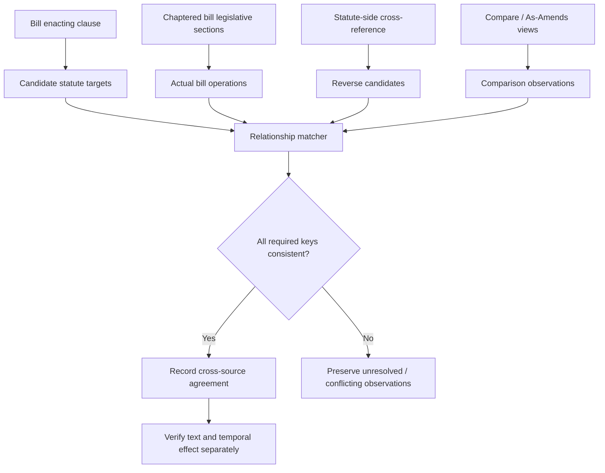

Comparison keys: `code_id`, exact `section_number`, `bill_id`, `statutes_year`, `chapter_number`, `chapter_section`, `operation`, `bill_version_id`, `billVersionSectionId` when present. Null values cannot be interpreted as matches.

### 7.4 Validation statuses

Use independent flags instead of a single overly broad `VERIFIED`:

`target_extracted`, `bill_section_matched`, `cross_source_agreement`, `text_verified`, `temporal_verified`, `provenance_verified`.

Conflicting evidence is a review finding; it is not overwritten by choosing whichever source appeared last.

---

## 8. Temporal and bitemporal modeling

### 8.1 Relevant time axes

| Time | Definition |
|---|---|
| `legislative_action_date` | Date of vote, amendment, hearing, action or filing |
| `approved_date` / `filed_date` | Legislative enactment milestones |
| `effective_from` | When an enacted provision takes legal effect |
| `operative_from` | When the provision begins to operate/apply |
| `sunset_date` / `repeal_date` | Scheduled expiration or repeal where legally applicable |
| `valid_from` / `valid_until` | Temporal validity of a legal assertion/version |
| `captured_at` | When specific web/PDF content was acquired |
| `recorded_at` / `superseded_at` | Database system-time for a structured assertion |

Do not infer one from another: a September 2024 chaptering event is not itself a verified January 2025 operative date. Urgency, retroactivity, conditional operations, staggered provisions, repeal/savings clauses and other amendments require independent legal interpretation and source verification.

### 8.2 Temporal rule record

```json
{
  "rule_id": "<rule-id>",
  "target_type": "SUBDIVISION_OR_SECTION",
  "target_id": "<statute-version-or-node-id>",
  "rule_type": "OPERATIVE_DATE",
  "date_value": null,
  "date_expression_exact": null,
  "conditional_on": [],
  "source_anchor_ids": [],
  "resolution_status": "UNRESOLVED"
}
```

If the same statute has subdivisions with different operative dates, store time at the subdivision/operation level. For a historical query, filter on supported legal intervals **before** ranking by semantic similarity. Store database system time separately to support audit of retrospective corrections.

### 8.3 Temporal question algorithm

1. Resolve the exact statute/subdivision identity.
2. Determine the user's target legal date and any relevant factual period.
3. Fetch historical version candidates and commencement rules.
4. Evaluate effective/operative/retroactive/conditional clauses as supported.
5. Resolve applicable text and exceptions; do not mix future text into past results.
6. Return the version and precise evidence—or declare incomplete historical coverage.

---

## 9. Relational SQLite knowledge model

### 9.1 Logical table families

| Family | Tables |
|---|---|
| Code hierarchy | `codes`, `hierarchy_nodes`, `code_groups`, `group_hierarchy` |
| Statutes | `statutes`, `section_occurrences`, `statute_versions`, `paragraphs`, `subdivision_nodes` |
| Bills | `legislative_sessions`, `bills`, `bill_versions`, `bill_sections`, `bill_events`, `bill_status_observations` |
| Legislators/votes | `legislators`, `roll_calls`, `vote_positions` |
| Analyses | `analysis_documents`, `analysis_pages`, `analysis_mentions` |
| Amendment graph | `amendment_targets`, `amendment_operations`, `statute_bill_cross_refs`, `comparison_views` |
| Citation graph | `citation_occurrences`, `citation_resolutions` |
| Temporal | `time_assertions`, `commencement_rules`, `temporal_intervals`, `system_assertion_versions` |
| Provenance | `source_objects`, `source_captures`, `source_anchors`, `extraction_runs`, `evidence_links` |
| Processing | `crawl_jobs`, `crawl_attempts`, `navigation_actions`, `validation_findings`, `import_batches` |
| AI | `search_documents`, FTS virtual tables, `embedding_metadata`, `research_queries`, `answer_claims` |

### 9.2 Database ER model

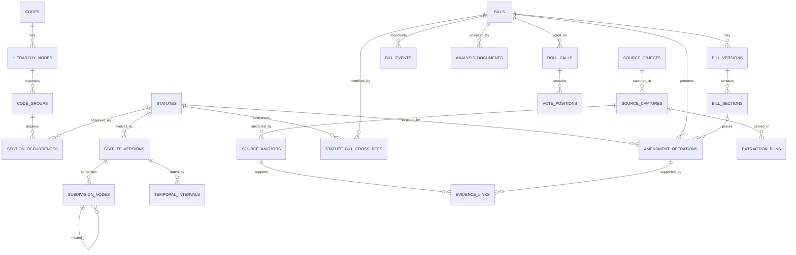

### 9.3 Primary keys, uniqueness, and constraints

- Stable natural-entity key: `UNIQUE(code_id, section_number_normalized)` for statute **identities** (not occurrences).
- `UNIQUE(bill_id, version_identifier)` for bill versions where identifier is known.
- Separate, immutable source object uniqueness by `sha256`; multiple capture rows may point to it.
- Section version uniqueness must incorporate content/provenance and distinguish the same text captured on distinct dates when necessary.
- Subdivision uniqueness scoped to `statute_version_id` and `legal_path` **only when paths are proven unique**; otherwise preserve distinct occurrence IDs and raise anomalies.
- `FOREIGN KEY`, `CHECK`, `NOT NULL`, transaction boundaries, repeat-import idempotency and migration versions are required.
- Index foreign keys, dates, normalized citation keys and amendment targets. SQLite `PRAGMA foreign_keys=ON` per connection.

### 9.4 Example indexes (after table creation)

```sql
CREATE INDEX IF NOT EXISTS idx_statutes_code_section ON statutes(code_id, section_number);
CREATE INDEX IF NOT EXISTS idx_versions_statute ON statute_versions(statute_id);
CREATE INDEX IF NOT EXISTS idx_operations_target ON amendment_operations(statute_id, bill_id);
CREATE INDEX IF NOT EXISTS idx_operations_bill ON amendment_operations(bill_id);
CREATE INDEX IF NOT EXISTS idx_crossrefs_statute ON statute_bill_cross_refs(statute_id);
CREATE INDEX IF NOT EXISTS idx_events_bill_date ON bill_events(bill_id, action_date);
CREATE INDEX IF NOT EXISTS idx_temporal_version_dates ON temporal_intervals(statute_version_id, valid_from, valid_until);
```

These are **illustrative names for the planned unified schema**, not a migration that has already been run. Do not create one physical table per division or section: SQL filters and indexes scale much better.

---

## 10. JSON contracts, exports and identifiers

### 10.1 One JSON per statute, one per bill

Use SQLite as the canonical query store. Generate JSON exports for portability, inspection, backup, or sharing; do not maintain two independently editable sources of truth.

**Statute export** (`BPC_1601.1.json`):

```json
{
  "schema_version": "11.0",
  "statute_id": "BPC:1601.1",
  "identity": {"code_id": "BPC", "section_number_exact": "1601.1."},
  "hierarchy_node_ids": [],
  "source_occurrence_ids": [],
  "statutory_versions": [],
  "amendment_operation_ids": ["<operation-id>"],
  "statute_bill_cross_ref_ids": [],
  "internal_citation_edge_ids": [],
  "temporal_rule_ids": [],
  "source_capture_ids": [],
  "validation": {"coverage": "PARTIAL", "findings": []}
}
```

**Bill export** (`202320240SB1453.json`):

```json
{
  "schema_version": "11.0",
  "bill_id": "202320240SB1453",
  "identity": {"session": "2023-2024", "type": "SB", "number": "1453"},
  "versions": [],
  "legislative_sections": [],
  "enacting_clause_targets": [],
  "amendment_operation_ids": [],
  "history_events": [],
  "status_observations": [],
  "analyses": [],
  "roll_calls": [],
  "comparison_view_ids": [],
  "source_capture_ids": [],
  "validation": {"coverage": "PARTIAL", "findings": []}
}
```

### 10.2 Relationship contract

```json
{
  "relationship_id": "<unique-id>",
  "bill_id": "202320240SB1453",
  "bill_version_id": "<verified-version-id-or-null>",
  "bill_section_id": null,
  "statute_id": "BPC:1601.1",
  "subdivision_node_id": null,
  "operation": "AMEND",
  "discovery_method": "ENACTING_CLAUSE",
  "old_statute_version_id": null,
  "new_statute_version_id": null,
  "source_anchor_ids": [],
  "validation": {
    "target_extracted": true,
    "bill_section_matched": false,
    "text_verified": false,
    "temporal_verified": false
  }
}
```

Never insert whole bill analysis PDFs, vote lists or full HTML under each statute JSON. Link them by stable IDs and export them on demand.

### 10.3 Source-aware link generation

Statute direct-link pattern:

`https://leginfo.legislature.ca.gov/faces/codes_displaySection.xhtml?lawCode=BPC&sectionNum=1601.1.`

Bill history pattern:

`https://leginfo.legislature.ca.gov/faces/billHistoryClient.xhtml?bill_id=202320240SB1453`

Persist both `derived_url` and `url_validation_status` until the page has actually been retrieved. For special sessions/old bills, derive IDs only after a source-verified session match.

---

## 11. Search, indexing, ranking and retrieval

### 11.1 Retrieval stack

1. **Exact citation resolver:** `BPC § 1601.1`, subdivisions and canonical IDs.
2. **Temporal filter:** legal time first; exclude known-inapplicable candidates.
3. **FTS5/BM25:** statutory text and analysis passages.
4. **Cross-reference/graph traversal:** relationships and reverse citations.
5. **Optional embeddings:** conceptual retrieval of relevant text; not authority selection.
6. **Fusion/reranking:** RRF on eligible candidates, boosted by exact match, temporal correctness and source verification.
7. **Evidence bundle:** cap context to exact, relevant paragraphs and their sources.

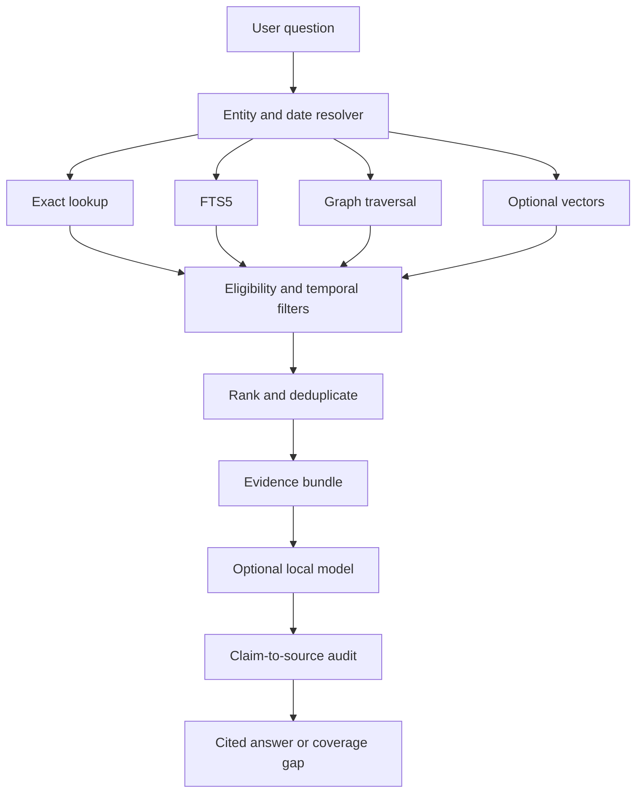

### 11.2 Suggested research tool API

```python
resolve_citation(text: str)
get_statute(code: str, section: str)
get_statute_version(code: str, section: str, legal_date: str)
get_subdivision(version_id: str, legal_path: str)
get_bill(bill_id: str)
get_bill_versions(bill_id: str)
get_bill_history(bill_id: str)
get_bill_analyses(bill_id: str)
get_bill_votes(bill_id: str)
get_amendment_operations(statute_id: str | None, bill_id: str | None)
get_cross_references(statute_id: str)
get_reverse_citations(statute_id: str)
compare_versions(old_version_id: str, new_version_id: str)
get_source_evidence(entity_id: str)
validate_claims(claims: list)
```

All local AI operations should return structured records, not unconstrained text. The language model explains the records; deterministic tools determine citations, IDs and date eligibility.

### 11.3 Answer artifact

```json
{
  "question": "<exact question>",
  "resolved_statutes": [],
  "resolved_bills": [],
  "requested_legal_date": null,
  "claims": [
    {
      "statement": "<specific supported claim>",
      "evidence_anchor_ids": [],
      "validation_status": "PENDING"
    }
  ],
  "coverage_gaps": [],
  "source_captures_used": [],
  "answer_generated_at": null
}
```

Any proposition without source-backed support must be removed, labeled as analysis/inference, or reported as unresolved.

---

## 12. Quality control, failure recovery and observability

### 12.1 Validation matrix

| Check | Mechanism | Result field |
|---|---|---|
| Original integrity | Re-hash raw source file | `source_integrity` |
| URL / navigation | Reconstruct action and confirm response | `navigation_verified` |
| Hierarchy | Parent-child, source ordering | `hierarchy_verified` |
| Statute extraction | Compare text and footer against original | `text_verified` |
| Subdivision | Nested legal paths, offsets, order | `subdivision_verified` |
| Bill version | Bill/session/version and text provenance | `bill_version_verified` |
| Amendment | Target ↔ bill section ↔ cross-reference | `operation_verified` |
| Historical time | Evidence for effective/operative intervals | `temporal_verified` |
| Vote | Totals match positions and published record | `roll_call_verified` |
| AI answer | Each factual claim has valid evidence | `answer_audit` |
| Coverage | Expected versus captured/parsed/verified | `coverage_metrics` |

Keep **four separate denominators**: source discovery coverage, capture coverage, extraction coverage, validation coverage. Missing data is not proof that an event did not occur.

### 12.2 Retry and idempotency

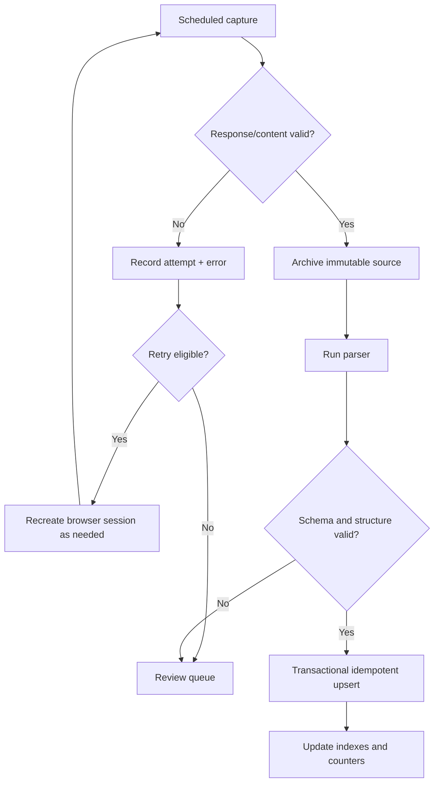

Preserve Selenium `invalid session id`, browser disconnects, missing expected elements, partial JSF submits, invalid URLs, parse errors and database-integrity failures as distinct error types. Retry network/browser failures; do not blindly retry deterministic parser validation failures.

### 12.3 Security and operational boundaries

Treat fetched HTML/PDF and extracted text as untrusted input. Do not execute embedded scripts from archived pages or treat source text as instructions to an AI agent. Sanitize filenames, parameterize SQL, bound crawler rate, respect site usage limits and preserve sensitive local notes separately from public legislative data. Maintain SQLite backups, migration checks and reproducible parser versions.

---

## 13. Physical directory layout and roadmap

```text
CALIFORNIA_LEGAL_AI/
├── config/
│   ├── sources.json
│   ├── crawl_profiles.json
│   ├── parser_rules.json
│   └── validation_rules.json
├── archive/
│   └── objects/sha256/<digest-prefix>/<digest>
├── database/
│   ├── california_legal_ai.sqlite
│   ├── migrations/
│   └── backups/
├── exports/
│   ├── statutes/BPC/BPC_1601.1.json
│   ├── statutes/BPC/BPC_40.json
│   ├── bills/2023-2024/202320240SB1453.json
│   ├── relations/
│   └── reports/
├── schemas/
│   ├── statute.schema.json
│   ├── bill.schema.json
│   ├── temporal.schema.json
│   ├── amendment.schema.json
│   └── source.schema.json
├── src/
│   ├── collectors/
│   ├── archive/
│   ├── classifiers/
│   ├── parsers/
│   ├── normalizers/
│   ├── resolvers/
│   ├── temporal/
│   ├── validators/
│   ├── database/
│   ├── retrieval/
│   ├── agents/
│   └── ui/
├── indexes/
├── tests/
└── logs/
```

### Delivery phases

| Phase | Goal | Acceptance test |
|---|---|---|
| 1 | Unified source archive + SQLite core | Reimport same capture without duplicate entities |
| 2 | BPC hierarchy and statute import | Exact statute+subdivision lookup with source anchor |
| 3 | SB 1453 bill importer | Seven page families, PDFs, bill versions, votes available |
| 4 | Enacting clause + chaptered section parser | All targets matched or explicitly unresolved |
| 5 | BPC § 40 cross-reference resolver | SB 541 / chapter / compare / as-amends linked |
| 6 | Temporal rule parser | Accurate supported historical version or explicit gap |
| 7 | Citation graph + FTS5 | Reverse reference and phrase search work |
| 8 | Local research tool interface | Typed responses with provenance |
| 9 | Optional local model + audit | Claims cited, unsupported claims flagged |
| 10 | Other code families + monitoring | Crawl/parse/verify coverage tracked |

---

## 14. Worked examples and acceptance tests

### 14.1 BPC § 40 → SB 541

**Input:** Inspected Code Cross-Reference, Compare, As-Amends HTML files.

**Expected representation:** `BPC:40` statute identity links to `201120120SB541`; Stats. 2011, Ch. 339, Sec. 1; target operation `ADD`; bill version section ID `3681281`; three distinct source capture IDs and navigation actions. Extract independent internal statutory citation edges where the wording cites other statutes. The comparator should **not** silently replace a historical statute version with display text from a comparison page.

### 14.2 BPC § 1601.1 → SB 1453

**Input:** SB 1453 target clause, seven HTML page families, two analysis PDFs and vote capture.

**Expected representation:** Bill ID `202320240SB1453`; chapter year 2024, chapter 483; target operation for § 1601.1 `AMEND`; separate bill versions, legislative events, source references and roll calls. Verify the chaptered bill section and historical text before marking the operation's text and temporal aspects verified.

### 14.3 Date-specific law

**Input:** `What did BPC § 1601.1 say on 2024-04-30?`

**Expected behavior:** Resolve exact identity, evaluate stored legal-date evidence, retrieve applicable historical version, identify its source; if missing, return `HISTORICAL_VERSION_NOT_CAPTURED` instead of presenting today's text as historical law.

### 14.4 Compound AI query

**Input:** `Which California statutes were added by bills with unanimous recorded Senate votes in 2024 and became operative after 2025-01-01?`

**Expected behavior:** Query roll calls, verify vote metadata and meaning of unanimous recorded vote; join enacted bill operations, statute targets, temporal commencement rules and source anchors; return supported matches only. Missing temporal evidence cannot satisfy the query by assumption.

---

# 16. UNIFIED ARCHITECTURE — FINAL SYNTHESIS

**This is the unified design, combining all preceding modules in one data flow.** The components preceding this section are specifications; the diagram and sequence below define how they operate together as one local system.

## 16.1 Single canonical flow

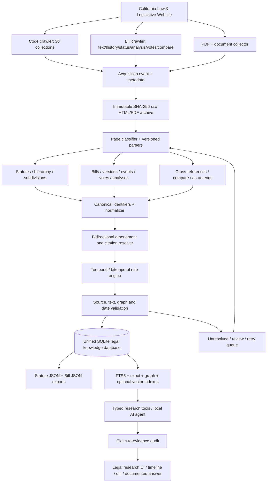

## 16.2 Shared identity and integrity contract

Every part of the system uses the same identifiers:

| Canonical entity | Key | Cross-system connection |
|---|---|---|
| Statute | `code_id:section_number` | Hierarchy, versions, operations, citations |
| Statute version | Version-scoped stable ID | Text, subdivisions, temporal rule, source |
| Bill | Legislative session + bill type + number | Versions, actions, analyses, votes |
| Bill legislative section | Bill version + section occurrence | Exact amendment-operation proof |
| Amendment operation | Unique operation ID | Bill section ↔ statute ↔ historical versions |
| Source object | SHA-256 | Immutable original content |
| Source capture | Unique acquisition-event ID | URL, navigation, capture date |
| Source anchor | Source capture + location | Every extracted assertion and cited AI claim |
| Temporal assertion | Unique rule ID | Legal applicability + source and review status |

**Single source of truth:** SQLite normalized legal entities and relationships, backed by immutable source bytes; individual statute/bill JSONs are generated projections. Source objects are never mutated, and corrected extractions create new provenance records.

## 16.3 Unified processing transaction

```text
DISCOVER
  → SCHEDULE
  → FETCH / JSF NAVIGATE
  → PRESERVE EXACT SOURCE
  → HASH + REGISTER CAPTURE
  → CLASSIFY PAGE
  → EXTRACT LEGAL STRUCTURES
  → NORMALIZE IDs
  → RESOLVE HIERARCHY + LINKS
  → RECONCILE BILL→STATUTE & STATUTE→BILL
  → RESOLVE LEGAL TIME
  → VALIDATE FACTS + SOURCE ANCHORS
  → TRANSACTIONAL SQLITE UPSERT
  → UPDATE FTS/GRAPH/OPTIONAL VECTOR INDEXES
  → EXPORT JSON (ON DEMAND)
  → EXPOSE TYPED AI TOOLS
  → GENERATE EVIDENCE-LINKED ANSWER
  → AUDIT EACH CLAIM
```

## 16.4 Essential build order

**Build one complete vertical slice before expanding to every code:**

1. **BPC § 40 + SB 541:** code section, cross-reference, comparison, as-amends, raw HTML, source linkage.
2. **BPC § 1601.1 + SB 1453:** bill versions, enacting clause, chaptered legislative sections, events, vote records, two analysis PDFs, precise amendment relationship.
3. **Temporal + citation layer:** dates, applicability, paragraph-level citations, validation gaps.
4. **FTS5 and exact legal research interface:** test end-to-end question-to-source trace.
5. **Expand to remaining BPC captures and all other code targets**, monitoring independent coverage counters.

## 16.5 Final acceptance criterion

A completed response must be able to follow the chain:

**Question → Canonical legal entity → Applicable dated version → Exact paragraph/subdivision → Legislative operation → Chaptered bill section → Bill history/analysis/votes → Original HTML/PDF source anchor → Verifiable claim**.

If a link in the chain has not been captured or verified, the engine states which link is missing. This is the core distinction between a searchable pile of documents and a reliable, temporal legal research system.

---

**Implementation status:** This Markdown is a *design specification*. It does **not** assert that the unified V12 SQLite schema, automated amendment matcher, complete historical corpus, or production local-AI agent are implemented. Existing captured datasets remain separate inputs until migrations and reconciliations are executed and tested.


---

# 17. V12 ENGINEERING DECISIONS AND CORRECTIONS

This section **refines and, where inconsistent, supersedes** earlier V11 design guidance. Historical dataset counts and observed captures in §1.2 remain historical observations from the supplied V11 document, not a fresh inventory or revalidation of the underlying files.

## 17.1 Fixed decisions

| Question | V12 decision | Rationale |
|---|---|---|
| Database of record | One transactional SQLite database; immutable external blob directory | Reliable foreign keys and queryable relations without redundant blobs |
| Raw versus DOM | Separate source representations (`RAW_RESPONSE`, `RENDERED_DOM`, `ORIGINAL_PDF`) | Browser DOM differs from transmitted HTML |
| Entity identity | Stable natural keys + internal integer PKs + unique immutable version IDs | Human-readable citations without fragile joins |
| Statute versions | Distinguish *observed text version*, *legal validity interval*, *capture observation* | A captured page is not proof of historical applicability |
| Parsing | Pure, deterministic, versioned parsers emit structured observations | Reprocessing must not alter archived evidence |
| Resolutions | Candidate → corroborated → validated, with conflict records | Prevent confident false joins |
| Legal time | Tri-state applicability: `APPLICABLE`, `NOT_APPLICABLE`, `UNKNOWN` | Missing dates cannot become negative evidence |
| NLP | Exact citation and temporal gates before BM25 / graph / vector | Similarity cannot outrank correct law or date |
| Embeddings | Optional, disposable index derived from verified text | Models can change without rewriting evidence |
| Front end | Source viewer + hierarchy browser + evidence panel + query engine | Traceable navigation before generative features |
| Source support | Span-anchored assertions; every legally material claim links to source evidence | Auditable output |
| Extensibility | Generic `jurisdiction`, `corpus`, `source_family`; California-specific parser plugin | Future states/federal sources without schema duplication |

## 17.2 Corrections to broad V11 simplifications

1. **Do not infer a legal version identifier from SHA-256 alone.** Identical text can recur in distinct legal periods, and different captures can show changed presentation without substantive change. Keep text digest, observed version, legal interval, and source observation separate.
2. **A release date, effective date, operative date, and historical applicability are not synonyms.** Attach dates to the precise provision and to the supporting enacted rule; support contingencies and unknowns.
3. **Parent/child hierarchy is not a universal hardcoded sequence.** Store ordered node edges with source-based path and `node_type`, including duplicate headings and missing levels.
4. **A `billVersionSectionId` is a source-site identifier, not necessarily a universal key.** Namespace by provider and keep raw value.
5. **A compare-page presentation is an observation, not automatically a complete legal diff.** A validated diff requires both authenticated text sides or explicit, reviewed provenance for the comparison.
6. **Do not use a bare `validation_status='VERIFIED'` for complex relationships.** Validation is multidimensional: identity, text, provenance, statute operation, legal time, and cross-source corroboration.
7. **Do not treat string-level NLP entities as statutory entities without resolution.** Mentions, candidates, confirmed targets and authoritative source text are separate records.
8. **A public website has more than a search box.** The first version should expose coverage, missing source alerts, original document viewing, and explicit historical uncertainty.

# 18. DATABASE INVARIANTS AND MIGRATION-READY CORE SQL

## 18.1 Four persistence layers

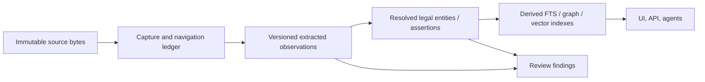

The archive is authoritative about **what was captured**, not automatically about the correctness or legal force of the captured content. Resolved legal records represent the system's evidenced and reviewable conclusions. Search indexes are reconstructible views, not primary storage.

## 18.2 Minimum stable contracts

Recommended main keys:

- `jurisdiction_id`: `US-CA` (later extendable).
- `corpus_id`: e.g., `US-CA-STATUTES`, `US-CA-BILLS`, `US-CA-RULES`.
- `statute_key`: e.g., `US-CA:BPC:1601.1` (canonical identity; punctuation-normalization stored separately from source).
- `bill_key`: e.g., `US-CA:2023-2024:SB:1453` (canonical identity, plus source-site bill ID).
- `text_version_id`: internal stable UUID or assigned surrogate for one observed/legal text version.
- `source_object_id`: SHA-256 of exact **bytes** with representation and digest algorithm metadata.
- `source_capture_id`: unique per capture attempt that succeeds and yields an observable representation.
- `extraction_run_id`: unique per source object + parser build + configuration + run intent.
- `source_anchor_id`: source object or capture and an exact location addressing convention.

Represent unknown values as SQL `NULL` plus an explicit status/reason; never substitute `1900-01-01`, `9999-12-31`, or zero to mean unknown. An **open-ended interval** may use a NULL end only when its open-ended nature is supported; `UNKNOWN` interval state remains distinct.

## 18.3 Executable core DDL (foundation only)

The following SQLite SQL is intended as a directly executable **core foundation**, not a full migration of all §9.1 families. Other domain tables should be added in subsequent migrations after the core passes tests. Do not combine it with existing schemas without inspecting their table names and migrations.

```sql
PRAGMA foreign_keys = ON;
PRAGMA journal_mode = WAL;

CREATE TABLE IF NOT EXISTS schema_migrations (
  migration_id TEXT PRIMARY KEY,
  applied_at TEXT NOT NULL DEFAULT CURRENT_TIMESTAMP,
  checksum TEXT NOT NULL
);

CREATE TABLE IF NOT EXISTS jurisdictions (
  jurisdiction_id TEXT PRIMARY KEY,
  display_name TEXT NOT NULL
);

CREATE TABLE IF NOT EXISTS corpora (
  corpus_id TEXT PRIMARY KEY,
  jurisdiction_id TEXT NOT NULL REFERENCES jurisdictions(jurisdiction_id),
  corpus_kind TEXT NOT NULL,
  display_name TEXT NOT NULL,
  CHECK (corpus_kind IN ('STATUTES','BILLS','RULES','REGULATIONS','CASES','OTHER'))
);

CREATE TABLE IF NOT EXISTS source_objects (
  source_object_id INTEGER PRIMARY KEY,
  sha256 TEXT NOT NULL,
  representation TEXT NOT NULL,
  mime_type TEXT NOT NULL,
  byte_length INTEGER NOT NULL CHECK(byte_length >= 0),
  storage_relpath TEXT NOT NULL,
  created_at TEXT NOT NULL DEFAULT CURRENT_TIMESTAMP,
  UNIQUE(sha256, representation),
  CHECK(length(sha256) = 64),
  CHECK(representation IN ('RAW_RESPONSE','RENDERED_DOM','ORIGINAL_PDF','ORIGINAL_FILE','TEXT_DERIVATIVE'))
);

CREATE TABLE IF NOT EXISTS source_captures (
  source_capture_id INTEGER PRIMARY KEY,
  source_object_id INTEGER NOT NULL REFERENCES source_objects(source_object_id),
  captured_at TEXT NOT NULL,
  method TEXT NOT NULL,
  requested_url TEXT,
  final_url TEXT,
  provider TEXT NOT NULL,
  http_status INTEGER CHECK(http_status BETWEEN 100 AND 599),
  navigation_json TEXT CHECK(navigation_json IS NULL OR json_valid(navigation_json)),
  metadata_json TEXT CHECK(metadata_json IS NULL OR json_valid(metadata_json))
);

CREATE TABLE IF NOT EXISTS extraction_runs (
  extraction_run_id INTEGER PRIMARY KEY,
  source_capture_id INTEGER NOT NULL REFERENCES source_captures(source_capture_id),
  parser_name TEXT NOT NULL,
  parser_version TEXT NOT NULL,
  config_sha256 TEXT NOT NULL,
  status TEXT NOT NULL CHECK(status IN ('RUNNING','PARSED','PARTIAL','FAILED','REVIEW')),
  started_at TEXT NOT NULL,
  completed_at TEXT,
  diagnostics_json TEXT CHECK(diagnostics_json IS NULL OR json_valid(diagnostics_json))
);

CREATE TABLE IF NOT EXISTS source_anchors (
  source_anchor_id INTEGER PRIMARY KEY,
  source_capture_id INTEGER NOT NULL REFERENCES source_captures(source_capture_id),
  extraction_run_id INTEGER REFERENCES extraction_runs(extraction_run_id),
  locator_type TEXT NOT NULL CHECK(locator_type IN ('BYTE_RANGE','CHAR_RANGE','DOM_XPATH','CSS_SELECTOR','PDF_PAGE_BBOX','PAGE_TEXT_RANGE')),
  locator_json TEXT NOT NULL CHECK(json_valid(locator_json)),
  excerpt_sha256 TEXT,
  verification_status TEXT NOT NULL DEFAULT 'PENDING'
    CHECK(verification_status IN ('PENDING','VALIDATED','REVIEW','FAILED'))
);

CREATE TABLE IF NOT EXISTS statutes (
  statute_id INTEGER PRIMARY KEY,
  corpus_id TEXT NOT NULL REFERENCES corpora(corpus_id),
  code_id TEXT NOT NULL,
  section_number_normalized TEXT NOT NULL,
  statute_key TEXT NOT NULL UNIQUE,
  UNIQUE(corpus_id, code_id, section_number_normalized)
);

CREATE TABLE IF NOT EXISTS statute_versions (
  statute_version_id INTEGER PRIMARY KEY,
  statute_id INTEGER NOT NULL REFERENCES statutes(statute_id),
  text_sha256 TEXT NOT NULL CHECK(length(text_sha256) = 64),
  version_label TEXT,
  version_kind TEXT NOT NULL DEFAULT 'OBSERVED'
    CHECK(version_kind IN ('OBSERVED','ENACTED','HISTORICAL_VERIFIED')),
  text_exact TEXT NOT NULL,
  created_at TEXT NOT NULL DEFAULT CURRENT_TIMESTAMP
);

CREATE TABLE IF NOT EXISTS section_occurrences (
  section_occurrence_id INTEGER PRIMARY KEY,
  statute_id INTEGER NOT NULL REFERENCES statutes(statute_id),
  statute_version_id INTEGER REFERENCES statute_versions(statute_version_id),
  source_anchor_id INTEGER NOT NULL REFERENCES source_anchors(source_anchor_id),
  source_label TEXT,
  text_sha256 TEXT NOT NULL
);

CREATE TABLE IF NOT EXISTS legal_time_assertions (
  legal_time_assertion_id INTEGER PRIMARY KEY,
  statute_version_id INTEGER NOT NULL REFERENCES statute_versions(statute_version_id),
  subdivision_node_id INTEGER,
  time_kind TEXT NOT NULL CHECK(time_kind IN
    ('EFFECTIVE','OPERATIVE','REPEAL','SUNSET','RETROACTIVE','CONDITIONAL')),
  exact_expression TEXT NOT NULL,
  date_value TEXT,
  resolution_status TEXT NOT NULL CHECK(resolution_status IN
    ('UNRESOLVED','CANDIDATE','CORROBORATED','VALIDATED','CONFLICT')),
  source_anchor_id INTEGER NOT NULL REFERENCES source_anchors(source_anchor_id)
);

CREATE TABLE IF NOT EXISTS evidence_assertions (
  assertion_id INTEGER PRIMARY KEY,
  subject_type TEXT NOT NULL,
  subject_key TEXT NOT NULL,
  predicate TEXT NOT NULL,
  object_json TEXT NOT NULL CHECK(json_valid(object_json)),
  extraction_run_id INTEGER NOT NULL REFERENCES extraction_runs(extraction_run_id),
  assertion_status TEXT NOT NULL CHECK(assertion_status IN
    ('EXTRACTED','CANDIDATE','CORROBORATED','VALIDATED','CONFLICT','REJECTED')),
  recorded_at TEXT NOT NULL DEFAULT CURRENT_TIMESTAMP,
  superseded_at TEXT
);

CREATE TABLE IF NOT EXISTS evidence_links (
  assertion_id INTEGER NOT NULL REFERENCES evidence_assertions(assertion_id),
  source_anchor_id INTEGER NOT NULL REFERENCES source_anchors(source_anchor_id),
  evidence_role TEXT NOT NULL CHECK(evidence_role IN
    ('SUPPORTS','CONTRADICTS','CONTEXT','DERIVED_FROM')),
  PRIMARY KEY(assertion_id, source_anchor_id, evidence_role)
);

CREATE TABLE IF NOT EXISTS validation_findings (
  finding_id INTEGER PRIMARY KEY,
  entity_type TEXT NOT NULL,
  entity_key TEXT NOT NULL,
  rule_id TEXT NOT NULL,
  severity TEXT NOT NULL CHECK(severity IN ('INFO','WARNING','ERROR','BLOCKER')),
  detail_json TEXT NOT NULL CHECK(json_valid(detail_json)),
  resolved_at TEXT
);

CREATE INDEX IF NOT EXISTS idx_captures_object_time ON source_captures(source_object_id, captured_at);
CREATE INDEX IF NOT EXISTS idx_anchors_capture ON source_anchors(source_capture_id);
CREATE INDEX IF NOT EXISTS idx_occurrences_statute ON section_occurrences(statute_id);
CREATE INDEX IF NOT EXISTS idx_versions_statute ON statute_versions(statute_id);
CREATE INDEX IF NOT EXISTS idx_time_version_kind ON legal_time_assertions(statute_version_id, time_kind);
CREATE INDEX IF NOT EXISTS idx_assertions_subject ON evidence_assertions(subject_type, subject_key);
CREATE INDEX IF NOT EXISTS idx_findings_entity ON validation_findings(entity_type, entity_key);
```

**DDL boundary notes:** This core does not yet implement recursive subdivision rows, complete bill entities, a true bitemporal interval engine, indexing triggers, or the crawl queue. `subdivision_node_id` in `legal_time_assertions` is intentionally unresolved in this foundation: add the FK when `subdivision_nodes` is introduced, in the same domain migration, then create the indexed provision-level temporal constraint. SQL `CHECK` permits NULL unless prohibited by `NOT NULL`, so required values are explicitly marked `NOT NULL`.

## 18.4 Logical graph and referential integrity

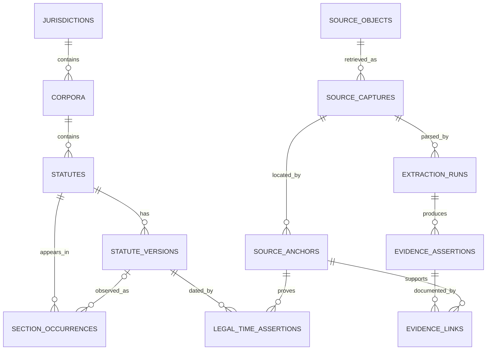

A validation assertion must not be automatically promoted because its extraction confidence is high. Syntactic correctness and legal correctness are distinct checks.

# 19. UNIFIED PARSER, PROVENANCE, AND EVIDENCE CONTRACTS

## 19.1 All parsers return one envelope

```json
{
  "contract_version": "12.0",
  "source_capture_id": 1001,
  "source_object_sha256": "<64-char SHA-256>",
  "parser": {"name": "california_code_section", "version": "1.0.0", "config_sha256": "<64-char SHA-256>"},
  "classification": {"type": "CODE_SECTION", "evidence": ["endpoint", "section-heading"]},
  "status": "PARTIAL",
  "observations": [
    {
      "observation_key": "section-text:1",
      "entity_kind": "STATUTE_TEXT_OBSERVATION",
      "fields": {"code": "BPC", "section_exact": "1601.1.", "text_exact": "<verbatim>"},
      "source_anchor_ids": [1234],
      "field_confidence": {"code": 1.0, "section_exact": 0.99},
      "unresolved_fields": ["historical_validity"]
    }
  ],
  "discovered_navigation": [],
  "validation_findings": [],
  "metrics": {"records_seen": 1, "records_extracted": 1}
}
```

The sample IDs and placeholders illustrate the shape, not actual source evidence. The parser must never fabricate `source_anchor_ids`. Each anchor should be created and checked against an archived representation.

## 19.2 Text and offsets

Preserve **three separately labeled strings**:

1. `text_exact`: faithful extracted characters, preserving original punctuation and section marks.
2. `text_index`: retrieval normalization, lowercasing/spacing only under versioned policies.
3. `text_display`: safe HTML-renderable form (escaped, with source boundaries and links).

Store an offset map, because whitespace normalization can invalidate source character positions. Keep DOM XPath/CSS selectors as navigation hints, not permanent anchors: select a structural node and verify it by text hash and local context. PDFs should preserve page numbers, spans and where possible geometry; OCR output is a separate derivative with engine/version and confidence, not the original source.

## 19.3 Stage contracts and promotion rules

| Stage | Input | Output | Promotion requirement |
|---|---|---|---|
| Capture | URL/navigation job | Source object + capture | Saved bytes, hash confirmed |
| Classify | Capture | Type + evidence | Structural signature present |
| Extract | Source + parser version | Observations and anchors | JSON schema and offset checks |
| Normalize | Observations | Canonical entity candidates | Identifier grammar and namespace |
| Resolve | Candidate relationships | Links + competing candidates | Multiple keys consistent; unresolved retained |
| Time | Enacted language + versions | Legal-time assertions | Separate verified commencement evidence |
| Index | Validated/eligible records | Exact/FTS/graph/vector | Provenance and version constraints satisfied |
| Answer | Eligible evidence | Claims and source bundle | Each claim has valid supporting anchor |

Enforce state transitions in code rather than editable free text. Persist transitions with `actor` (parser, validator, human), timestamp, rule ID, and prior/current state. A human override requires a reason and should never edit original source content.

# 20. TEMPORAL REASONING AND CONFLICT RESOLUTION

## 20.1 Date applicability is a decision, not a guessed timestamp

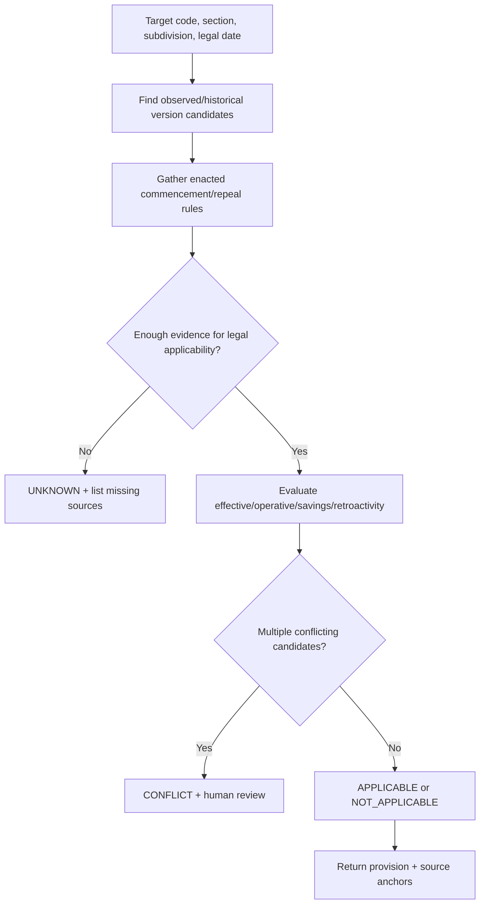

Maintain both **legal valid time** (`applicable_start`/`end`, including contingencies) and **database observation/system time** (`recorded_at`, `superseded_at`). A correction to a prior legal-time inference should add a new assertion version so historical answers remain auditable.

## 20.2 Conflict representation

A conflict includes `conflict_id`, entity, rule type, candidate assertions, source links, reason, detected date, reviewer status, and resolution basis. For example, a compare page showing an amended section while a separate source shows a later operative date is not necessarily a contradiction: one concerns text presentation and the other legal applicability. The conflict detector must type each assertion before comparing it.

## 20.3 Rule evaluator requirements

- Normalize dates but retain original expressions, e.g., “first day of the sixth month after …”.
- Track conditional activation, urgency, sunset, savings, multiple operative clauses, and retroactivity as rule nodes, not one date field.
- Retain `UNKNOWN` if referenced condition or effective-date evidence is absent.
- Evaluate provision-level rules before section-wide fallback; never silently overwrite a subdivision exception.
- Prefer explicit source-linked legal conditions; treat simple calendar defaults as policies that must be documented and individually validated for applicability, not assumed facts.

# 21. CRAWLER ORCHESTRATION, STORAGE AND INDEXING

## 21.1 Work as a directed acyclic graph

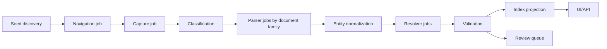

A job should contain `job_id`, `job_type`, `input_fingerprint`, `dependency_ids`, `priority`, `status`, `attempt_count`, `max_attempts`, `lease_until`, `last_error_code`, and timestamps. Use transactional job claims and an idempotency key, e.g., `job_type + input_fingerprint + parser_version`. A processing retry is not a new source-capture event unless the content is actually fetched again.

### Failure taxonomy

| Code | Recovery |
|---|---|
| `BROWSER_SESSION_INVALID` | Create a new browser session; resume uncommitted navigation |
| `JSF_VIEW_EXPIRED` | Reload stable starting page and replay permitted form navigation |
| `NAVIGATION_MISMATCH` | Preserve response and classify as unexpected; do not parse as statute |
| `RATE_LIMITED` | Backoff and reduce concurrency |
| `CONTENT_INCOMPLETE` | Inspect structural markers; recapture if appropriate |
| `PARSER_SIGNATURE_CHANGED` | Hold for parser maintenance; do not loop retries |
| `ANCHOR_MISMATCH` | Quarantine derived assertion until source offsets validate |
| `DB_CONSTRAINT_FAILED` | Roll back transaction, record row-level diagnostic |
| `TEMPORAL_CONFLICT` | Retain competing assertions; review |

## 21.2 Storage tradeoffs

Use external content-addressed files for raw HTML/PDF bytes and SQLite for metadata, canonical structure, evidence links, and query indexes. A single archive can be shared by statute/bill entities; never write full HTML into every joined row. If a large PDF requires FTS, index page-aware extracted text and link each passage to its source page. Optional compression is an archive transformation that must not replace the original-byte digest or hide extraction provenance.

## 21.3 Search indexes and incremental refresh

- **Exact**: unique canonical keys, section/subdivision path, bill/session identifiers.
- **FTS5**: text passages partitioned by corpus/source/version and never mixing historic/current claims.
- **Positional**: token start/end offsets and paragraph/section scope; bigram/trigram/phrase positions.
- **Graph**: typed relationships (`CITES`, `AMENDS`, `REPEALS`, `ADDS`, `APPEARS_IN`, `SUPPORTED_BY`) with validation levels.
- **Vectors**: optional embeddings; store `model_id`, revision, dimensionality, content digest, embedding timestamp; delete/rebuild safely.
- **Invalidation**: event-driven projection refresh when an extraction or resolved relation is superseded; old source remains archived.

# 22. LEGAL NLP AND PRECISION-FIRST RETRIEVAL

## 22.1 An NLP pipeline that remains useful without a large LLM

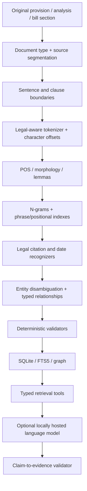

Treat POS and general NER tags as **features**, not authority. California legal text needs specialist grammars for citation punctuation, ranges, abbreviations, subsections (`(a)(1)(A)(i)`), bill identifiers, enacting verbs, exceptions, negative clauses, and temporal language. Retain the original token sequence and offsets; stemming and lemmatization produce additional normalized indexes, not revised source text.

## 22.2 Linguistic features and why they matter

| Feature | Storage | Use |
|---|---|---|
| Character / word n-grams | Token sequences and occurrence positions | Find variants, near-phrases, terminology |
| Bigrams / trigrams | Corpus + document/version + offsets | Phrase search and collocation |
| Part-of-speech tags | Model ID + offsets + label + confidence | Candidate clause/role parsing |
| Dependency relations | Span-scoped arcs | Subject, exception and obligation candidates |
| Citation grammar | Raw span + normalized candidate + type | Exact legal cross-reference resolver |
| Temporal expressions | Raw span + candidate rule AST | Applicability and event chronologies |
| Enacting operations | Verb, target and bill-section span | Amend/add/repeal relationships |
| Negation and exceptions | Clause boundary + conditional scope | Prevent reversal of meaning |
| Keywords/TF-IDF/BM25 | Versioned index | Fast lexical retrieval |
| Optional embeddings | Derived model/version | Recall for concepts, not legal validity |

## 22.3 Search behavior and ranking

1. Detect exact legal citations and date constraints.
2. Resolve jurisdiction/corpus, statute identity and subdivision path.
3. Gate candidates by evidence and temporal eligibility (`UNKNOWN` is segregated, not treated as verified).
4. Retrieve exact matches, BM25 passages, citation neighbors, and optional vector candidates.
5. Deduplicate using canonical version and source anchors.
6. Rerank with exact-path match, legal applicability, provenance level, section similarity and relationship type; use RRF among eligible retrieval channels.
7. Return passages, verified links, explicit conflicts, missing history, and a bounded source bundle.
8. Only then allow optional model summarization; each answer claim passes an evidence audit.

Set up a deterministic baseline before tuning any learned model. Measure wrong-version rate and unsupported-claim rate separately from ordinary search relevance. Do not claim “zero hallucination”; enforce traceability and abstention when support is inadequate.

## 22.4 Agent tool security

Tools should enforce typed arguments and fixed read-only SQL queries or parameterized query builders; do not let a language model execute arbitrary SQL, Python, JavaScript, browser scripts or database migrations on behalf of a public user. Provide a separate administrator workflow for crawling, reviewing and publishing. Source HTML is untrusted input and should never be able to invoke agent actions.

# 23. PRODUCT UI, EXTENSIBILITY, SECURITY AND PUBLIC LAUNCH

## 23.1 Primary website views

| View | Purpose | Minimum interaction |
|---|---|---|
| Code explorer | 30-source target tree | Expand parent-child hierarchy; direct source link |
| Section viewer | Exact law text + subdivisions | Click subdivision, copy legal citation, show source |
| Historical timeline | Dated versions and legal-status uncertainty | Date selector and supported/unknown flags |
| Bill profile | Text versions, legislative sections, events, votes and analyses | Jump from bill section to affected statute |
| Amendment comparator | Verified before/after, source compare view | Highlight changed spans and provenance |
| Cross-reference graph | Statute ↔ bill and statute ↔ statute | Filter edge type and validation level |
| Legal research | Exact citation + phrase + optional semantic search | Source passages and claims/citation panel |
| Source inspector | Original HTML/PDF, DOM selectors, offsets, hashes | Verify evidence location and capture metadata |
| Coverage and diagnostics | Source discovered/captured/parsed/validated counts | Filter unresolved failures and gaps |
| Admin review | Ambiguity, temporal conflicts, parser anomalies | Accept/reject with reason and audit trail |

## 23.2 Frontend/backend boundaries

A local Python API (for example, FastAPI) may expose `/codes`, `/statutes/{id}`, `/versions`, `/bills`, `/amendments`, `/citations`, `/sources`, `/search`, and `/coverage`. These are **proposed endpoint families**, not existing implementations. Use cursor pagination on large lists and avoid returning full raw documents in search responses. The browser UI should render archived HTML only in a safe, isolated viewer, rather than executing embedded scripts in the application's origin.

## 23.3 Growing beyond California

Extend via an adapter interface: `discover()`, `capture()`, `classify()`, `parse_hierarchy()`, `parse_provision()`, `parse_history()`, `parse_citations()`, and `resolve_temporal_rules()`. Each adapter must declare jurisdiction, source family, licensing/usage metadata, identifier grammar, publication cadence, and verification policies. Generic relations stay in the core schema; source-specific fields may remain in JSON extension fields until evidence warrants promoted columns.

**Separation of concerns:** California codes, California Rules of Court, State Bar rules, federal statutes, regulations, case law, and user-supplied private documents have different authority and publication mechanisms. They may share archival and NLP infrastructure, but they cannot share unqualified statutory-version or amendment parsers.

## 23.4 Operational safeguards

Use backups and reproducible migrations; run integrity and foreign-key checks after each import batch; isolate administrator access from public research; never expose private notes in public corpora; retain source licensing and attribution metadata; escape rendered HTML; bound crawler concurrency and obey applicable site rules; enforce download size and parser time limits; log audits without leaking sensitive query content.

# 24. V12 TEST STRATEGY AND RELEASE GATES

## 24.1 Must-pass fixtures

| Test ID | Fixture | Pass condition |
|---|---|---|
| T01 | Same raw capture twice | One source object, two capture events, no duplicated canonical statute |
| T02 | Browser rendered DOM differs from raw | Both representations separately hashed and retrievable |
| T03 | Statute has missing hierarchy level | Tree preserves actual parent-child source sequence |
| T04 | Repeated subsection marker / ambiguous path | Two observations preserved; finding issued; no silent overwrite |
| T05 | BPC §40 cross-reference / compare / as-amends | Three distinct view types with verified join keys or unresolved record |
| T06 | SB 1453 enacting targets | All parsed targets preserved; only corroborated operations promoted |
| T07 | Bill vote tally mismatch | Discrepancy finding, raw positions retained |
| T08 | Historical query with no old text | `HISTORICAL_VERSION_NOT_CAPTURED`, not today's text |
| T09 | Different effective and operative dates | No substitution of one for the other |
| T10 | Contingent rule with unknown trigger | Applicability is `UNKNOWN` |
| T11 | Archived page changes CSS but not text | Source object change, legal-change status remains unproven |
| T12 | Malformed JSF navigation | Navigational retry/review, no invented statute content |
| T13 | Unsupported AI claim | Claim omitted or marked unsupported; no fabricated anchor |
| T14 | Delete and rebuild search index | Same eligible entities and provenance after reindex |
| T15 | Failed transaction during batch | Rollback without orphaned source anchors/assertions |
| T16 | Different jurisdiction/source family | Adapter and corpus isolation; no cross-source identity collision |

These are acceptance **specifications**, not test results. Report actual counts and pass/fail only after implementation.

## 24.2 Measurable quality metrics

Maintain denominators explicitly:

- `discovery_coverage = observed_discoveries / expected_discoveries` (when expectation can be established).
- `capture_coverage = valid_captures / discovered_jobs`.
- `parse_coverage = successfully_parsed_captures / valid_captures`.
- `validation_coverage = validated_entities / extracted_entities`.
- `source_anchor_integrity = valid_anchors / checked_anchors`.
- `temporal_verification = supported_date_assertions / extracted_date_assertions`.
- `cross_reference_precision = correctly_resolved_edges / audited_resolved_edges`.
- `historical_wrong_version_rate = wrong_version_answers / audited_dated_answers`.
- `unsupported_claim_rate = unsupported_claims / audited_answer_claims`.

For undefined denominators, display `N/A` rather than 0% or 100%. Record dataset/sample IDs, parser versions and timestamps beside all metrics.

## 24.3 Milestones with explicit deliverables

1. **Foundation:** SQLite core, immutable archive, migrations, one CLI importer, reproducible capture ledger, T01/T02/T15.
2. **One statute vertical slice:** BPC §40 text, hierarchy, subdivisions, three cross-reference views, exact anchors and source inspector.
3. **One bill vertical slice:** SB 1453 page families, version identity, bill sections, events, analyses, votes, 63 target candidates, independent operation validation.
4. **Temporal and graph:** actual commenced-time evidence, conflict ledger, date-specific search, typed citation edges, T08/T09/T10.
5. **NLP retrieval:** FTS5 + phrase positions + legal citation resolver, optional vector index, evidence-first API.
6. **Product:** code explorer, statute/bill profiles, source comparator, coverage panel, protected admin review.
7. **Expansion:** remaining captured BPC groups first; then other California codes; later separate corpus adapters.

Each milestone is complete only with repeatable import, migration rollback/rebuild instructions, test fixtures, coverage numbers, and source traceability. Avoid declaring corpus-level completeness based on an isolated capture count.

---

# V12 UNIFIED ENGINEERING CONTRACT

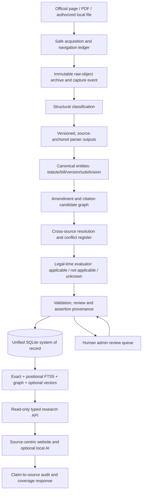

**Final V12 rule:** *A document is not an assertion; an extraction is not a validated relationship; a source capture is not an applicable historical version; and a semantically similar passage is not legal authority.* Every surfaced legal conclusion must retain its lineage to the precise captured source, version, subdivision, governing date, and unresolved limitations.

**Scope disclosure:** V12 extends/refines the attached V11 document. No new BPC/SB 1453 files were analyzed for this revision, and the SQL above is supplied as a proposed foundation rather than a migration applied to an existing database.
